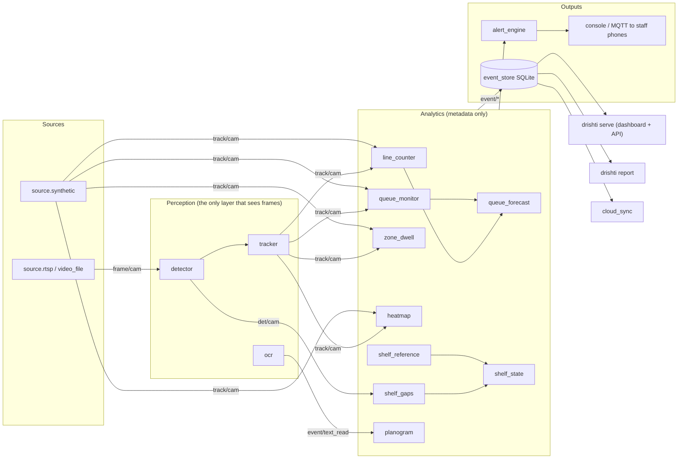

# DukaanDrishti prototype: a modular edge-vision engine

> **First time, on the Windows laptop?** Follow [PROTOTYPE0_WINDOWS.md](PROTOTYPE0_WINDOWS.md) step by step.

Every feature of the SIH 2026 retail prototype (PS SIH26179) is a **small module** that talks
to the others only through messages. You can build, test, replace or move any module without
touching the rest. Nothing gets rebuilt from scratch when one part changes.

```bash
pip install -e ".[vision,dev]"          # or: nix develop, then the same pip line
python -m drishti run configs/synthetic_demo.yaml      # a simulated store, no camera or model needed
python -m drishti report --db out/synthetic/events.db  # daily KPI report
python -m drishti serve  --db out/synthetic/events.db  # dashboard on http://127.0.0.1:8000
python -m drishti snapshot clips/door.mp4               # a frame with a pixel grid, for drawing zones
pytest                                                  # 33 tests: every module, plus the whole pipeline
python -m drishti serve --db out/synthetic/events.db   # then open /alerts on a phone on the same Wi-Fi
```

**What the simulated demo shows.** The simulated store has 60 minutes of trading with a rush
from minute 20 to 32. At 17:26 the forecast asks for a second counter, before anyone is
waiting. The simulated manager opens it, and the queue never goes above 3 people (average
wait 19 s). Run the same scenario with `respond_to_alerts: false` and nobody acts on the
alert: the queue reaches 18 people and the average wait is over 5 minutes. These figures come
from the simulator, not a real store. They show how the system works, not how accurate it is.
Accuracy has to be measured on your own recorded clips with `tools/benchmark.py`.

---

## How it fits together



### The contract, and why modules don't break each other

| Topic | Type | Produced by | Notes |
|---|---|---|---|
| `frame/<camera>` | `Frame` | sources | raw image, **local only**, never stored or sent anywhere |
| `det/<camera>` | `Detections` | detector | boxes + labels, `meta.infer_ms` |
| `track/<camera>` | `Tracks` | tracker, simulator | boxes with stable IDs; `anchor` = feet position |
| `event/<type>` | `Event` | analytics, integrations | e.g. `entry`, `dwell`, `queue_forecast`, `shelf_gap` |
| `alert/<kind>` | `Alert` | alert engine | what staff should do, with severity |
| `metric/<name>` | `Metric` | ops.health | fps, latency, temperature |

All types live in `drishti/core/types.py`. Rules that keep the code modular:

1. **Modules only import `drishti.core`**, never another module. They meet on the bus.
2. **Frames stop at perception.** `output.mqtt_bridge` refuses `frame/` topics, which is how "no video leaves the box" is enforced in code rather than just promised.
3. **Time comes from the data**, not the wall clock. Replaying a clip gives the same events every time, so tests and benchmarks are repeatable.
4. **Configuration beats code.** Zones, lines, thresholds and alert wording live in YAML. Replacing an implementation means changing `use:` in the YAML.
5. **Optional libraries are imported in `setup()`.** A missing OCR or MQTT library breaks only the module that needs it.
6. **Every module has a test that feeds it hand-made messages.** See `tests/helpers.py`.
7. **The event store is the hand-off point.** The dashboard, reports and cloud sync only read `events.db`, so the UI can be built from a simulator recording.

---

## Module map

Status: ✅ works and is tested · 🟡 written, not yet run against real hardware or its library · 🧩 stub with a TODO.
"ANPR" marks modules that the BEL traffic/ANPR entry can use unchanged.

| # | Module (`use:` name) | What it does | Listens → publishes | Status | Effort | ANPR |
|---|---|---|---|---|---|---|
| M00 | `drishti.core` | bus, types, module base, YAML pipeline, geometry | — | ✅ | — | ✔ |
| M01 | `source.synthetic` | simulated shoppers, queues and rush; reacts to alerts | → `track/*` | ✅ | S | |
| M02 | `source.video_file` | replays recorded clips as cameras | → `frame/*` | ✅ | S | ✔ |
| M03 | `source.rtsp` | live IP cameras or phones | → `frame/*` | 🟡 | S | ✔ |
| M04 | `perception.detector` | YOLOv8/11 ONNX: people, products, labels | `frame` → `det` | ✅ ¹ | M | ✔ |
| M05 | `perception/backends.py` | onnxruntime ✅ · **litert_qnn (Qualcomm NPU)** 🧩 | — | ✅/🧩 | M | ✔ |
| M06 | `perception.tracker` | stable IDs: IoU ✅ · ByteTrack 🟡 | `det` → `track` | ✅ | M | ✔ |
| M07 | `perception.ocr` | reads shelf labels and prices; Indian plate parser | `frame`+`det` → `text_read` | ✅ ² | M | ✔ |
| M08 | `perception.redacted_snapshots` | blurred debug stills for setting up zones | `frame`+`det` → files | ✅ | S | ✔ |
| M09 | `analytics.line_counter` | entries and exits | `track` → `entry`/`exit` | ✅ | S | ✔ |
| M10 | `analytics.zone_dwell` | time spent at displays or aisles | `track` → `dwell` | ✅ | S | ✔ |
| M11 | `analytics.heatmap` | where people spend time (+ floor-plan mapping) | `track` → `heatmap` | ✅ | S | ✔ |
| M12 | `analytics.queue_monitor` | queue length, wait and billing time per counter | `track` → `queue_update` | ✅ | M | |
| M13 | `analytics.queue_forecast` | footfall → predicted rush → how many counters (Erlang C) | events → `queue_forecast` | ✅ | M | |
| M14 | `analytics.shelf_gaps` | gaps and fill level per slot; skips rows someone is blocking | `det` → `shelf_observation` | ✅ ³ | M | |
| M27 | `perception.shelf_reference` | shelf fallback: diffs the frame against a full/empty reference photo, no model needed | `frame` → `shelf_observation` | ✅ | S | |
| M15 | `analytics.shelf_state` | voting over frames → OK / LOW / EMPTY | → `shelf_gap` | ✅ | S | |
| M16 | `analytics.planogram` | label text and price vs expected layout | `text_read` → `*_mismatch` | ✅ basic | M | |
| M17 | `output.alert_engine` | YAML rules → alerts, de-duplication, cooldown | `event/#` → `alert/*` | ✅ | S | ✔ |
| M18 | `output.console` | prints alerts | `alert/#` | ✅ | S | ✔ |
| M19 | `output.event_store` | SQLite log of everything | `event/alert/metric` | ✅ | S | ✔ |
| M20 | `output.mqtt_bridge` | sends events and alerts to a broker or phones, never frames | → MQTT | 🟡 | S | ✔ |
| M21 | `integration.pos_mock` | fake bills → conversion rate | `service_complete` → `pos_bill` | ✅ | S | |
| M22 | `integration.pos_csv` | real bills from a billing-software export | → `pos_bill` | 🟡 | S | |
| M23 | `integration.cloud_sync` | uploads daily summaries when online | SQLite → HTTPS | 🟡 | M | ✔ |
| M24 | `ops.health` | fps, model latency, SoC temperature | → `metric/*` | ✅ | S | ✔ |
| M25 | `drishti serve` | dashboard + JSON API over the event store, `/alerts` phone view (beep + vibrate on new alerts) | — | ✅ | M | ✔ |
| M26 | `drishti report` | daily KPI report · weekly/PDF 🧩 | — | ✅ | S | ✔ |
| T1 | `tools/setup_zones.py` | draw lines, zones and shelf slots on a snapshot → YAML | — | ✅ ⁴ | S | ✔ |
| T2 | `tools/aihub_export.py` | compile and time a model on a real QCS6490 (Qualcomm AI Hub) | — | 🟡 | S | ✔ |
| T3 | `tools/benchmark.py` | accuracy against hand counts | — | ✅ basic | S | ✔ |

¹ Tested with a fake model. You still need `models/yolov8n.onnx` (`yolo export model=yolov8n.pt format=onnx`).
² The Tesseract engine is tested. The RapidOCR adapter needs checking against the installed version.
³ It needs a product-detector model to work on real shelves (W2 below). M27 is the no-model
  fallback that publishes the same contract - use it until W2 is trained.
⁴ The geometry-to-YAML logic is unit tested and the OpenCV GUI backend is confirmed working on
  the Lenovo; the mouse/keyboard click-through itself still needs a human to try it once.

**Work not in the repo yet**, one card each:

| # | Work item | Where it plugs in |
|---|---|---|
| W1 | Fine-tune a person detector on your own overhead/angled store footage (Lenovo) | model file for M04 |
| W2 | Train a shelf product detector (SKU-110K + photos of your shelf) | model file for M04 → M14 |
| W3 | Qualcomm NPU backend: LiteRT + QNN delegate | `backends.py` (M05) |
| W4 | GStreamer / IM SDK source using the board's hardware video decoder | new source, same `frame/*` |
| W5 | Staff filter (staff-only zones, uniform colour) | between M06 and analytics |
| W6 | Staff alert app: MQTT → phone notification or PWA | behind M20 |
| W7 | Multi-store view (head office) | receiver for M23 |
| W8 | Browser-based zone drawing (replaces T1) | `drishti serve` |
| W9 | Mock store + recorded clips + hand counts | `data/`, used by T3 |

---

## Build order: who can work in parallel

| Wave | Parallel tracks | Done when |
|---|---|---|
| **1 (now)** | A: build the mock store and record clips (W9) · B: detector + tracker on the clips (M04, M06) on the AMD laptop · C: polish the dashboard using `out/synthetic/events.db` (M25) · D: try rush scenarios in the simulator (M12, M13) | entry counts from real clips appear on the dashboard |
| **2** | train the shelf model on the Lenovo (W2) → M14/M15 on a real shelf · OCR on real labels (M07, M16) · AI Hub export and timing (T2) | empty-slot alert from a real shelf; NPU latency numbers for the deck |
| **3** | Qualcomm backend (W3, W4) · phone alerts (W6, M20) · real bills (M22) · weekly report (M26) | the pipeline runs on the Qualcomm board or a Snapdragon phone |
| **4** | full run on the edge box · `tools/benchmark.py` · rehearse with the internet unplugged | accuracy numbers + a demo that works offline |

---

## Adding or replacing a module

```python
# drishti/modules/analytics/my_feature.py
from drishti.core import Module, Tracks

class MyFeature(Module):
    subscribes = ("track/{camera}",)          # {camera} comes from the YAML config

    def setup(self):
        self.require("camera")                # validate config, load models here

    def on_message(self, topic, tracks: Tracks):
        if len(tracks.items) > self.cfg.get("crowd", 10):
            self.emit("crowding", tracks.camera_id, tracks.ts, people=len(tracks.items))
```

Then add one line to `drishti/core/catalog.py` (`"analytics.my_feature": "drishti.modules.analytics.my_feature:MyFeature"`)
and list it in a pipeline YAML. Test it the way `tests/test_analytics.py` does, with `make()` and a few hand-made
`tracks(...)`. You don't need a camera or a model.

---

## The two laptops

- **AMD 3500U, NixOS: the store box.** `nix develop` gives Python, uv, Mosquitto, SQLite, ffmpeg and Tesseract, with the
  libraries that pip wheels need. Run pipelines on the CPU with `onnxruntime` and INT8 models. If it keeps up here,
  it will keep up on a Qualcomm NPU. (The flake hasn't been tested on your machine yet. Adjust it if nixpkgs complains.)
- **Lenovo i7-13650HX + RTX 4050 (6 GB): the lab.** Label data, train with `pip install ".[train]"` (Ultralytics), export
  ONNX, and replay clips quickly with `onnxruntime-gpu` (`providers: [CUDAExecutionProvider]`). WSL2 or Ubuntu gets CUDA
  working fastest.

Licensing note: Ultralytics YOLO is AGPL-3.0. That's fine for the hackathon, but raise it if you pitch a business model.
Detectors exported by Qualcomm AI Hub, or Apache-licensed ones (YOLOX, RT-DETR), avoid the issue.

## Layout

```
drishti/core/        types, bus, module base, catalog, pipeline, geometry
drishti/modules/     sources/ perception/ analytics/ outputs/ integrations/ ops/
drishti/api/         dashboard (static/index.html) + JSON API
drishti/reports/     KPI reports
configs/             synthetic_demo.yaml, retail_store.yaml, cameras/*.yaml
tools/               setup_zones.py, aihub_export.py, benchmark.py
tests/               one test file per layer + end-to-end
```
